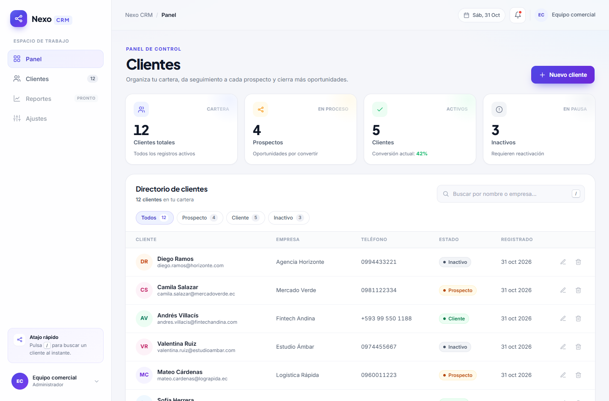
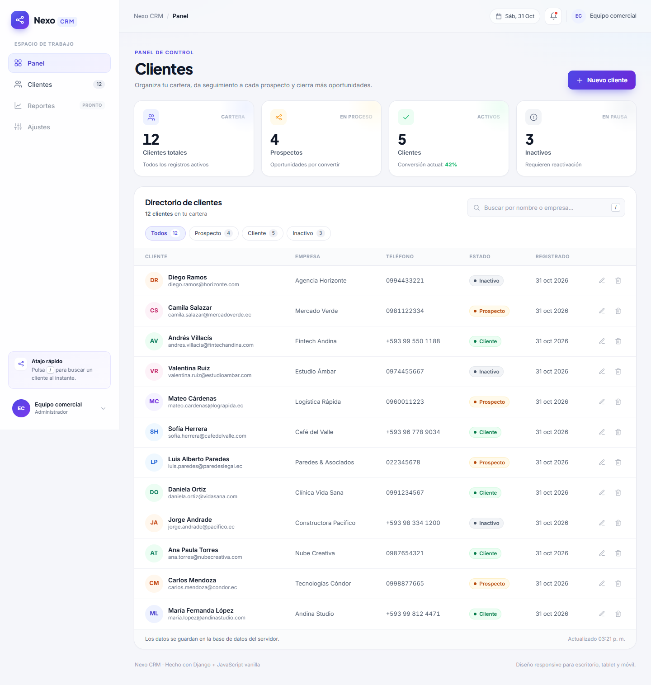
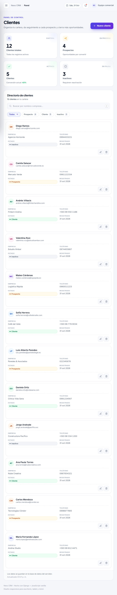
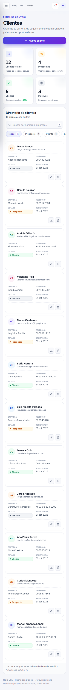
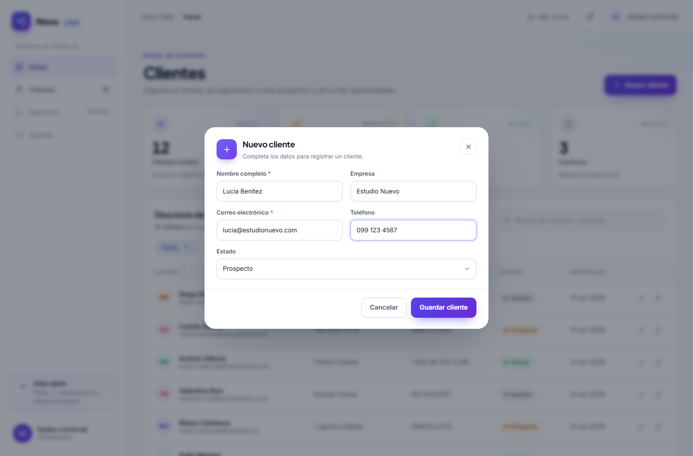
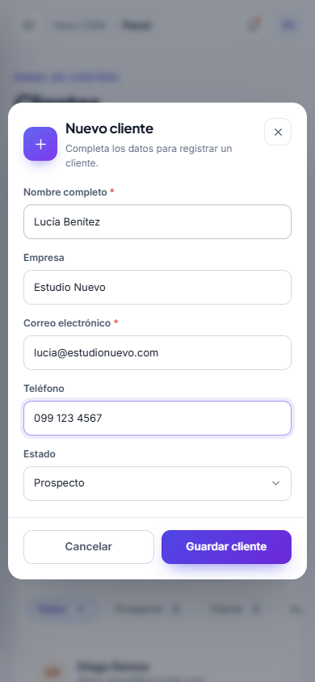

# Nexo CRM

Mini CRM para gestionar una cartera de clientes: crear, consultar, editar, buscar, filtrar y eliminar registros, con métricas en vivo y una interfaz responsive construida a medida.

> Prueba técnica para el puesto de **Junior Software Developer** en **CEO Marketing**.



---

## Tabla de contenidos

- [Demo y capturas](#demo-y-capturas)
- [Funcionalidades](#funcionalidades)
- [Stack tecnológico](#stack-tecnológico)
- [Estructura del proyecto](#estructura-del-proyecto)
- [Puesta en marcha local](#puesta-en-marcha-local)
- [Datos de demostración](#datos-de-demostración)
- [Pruebas automatizadas](#pruebas-automatizadas)
- [Docker](#docker)
- [API JSON](#api-json)
- [Modelo de datos](#modelo-de-datos)
- [Decisiones técnicas](#decisiones-técnicas)
- [Flujo de trabajo con Git](#flujo-de-trabajo-con-git)
- [Integración continua](#integración-continua)
- [Variables de entorno](#variables-de-entorno)
- [Checklist del desafío](#checklist-del-desafío)
- [Publicación en GitHub](#publicación-en-github)

---

## Demo y capturas

La aplicación se sirve en `http://localhost:8000/` y el panel de administración en `http://localhost:8000/admin/`.

| Escritorio | Tablet | Móvil |
| --- | --- | --- |
|  |  |  |

| Formulario de cliente | Confirmación de borrado |
| --- | --- |
|  | El borrado pide confirmación explícita antes de eliminar el registro. |

| Modal en móvil |
| --- |
|  |

---

## Funcionalidades

### Gestión de clientes

- **Crear** clientes desde un modal con validación en el navegador y en el servidor.
- **Listar** todos los registros con avatar generado a partir de las iniciales, empresa, teléfono, estado y fecha de registro.
- **Editar** cualquier cliente reutilizando el mismo formulario, precargado con sus datos.
- **Eliminar** con un diálogo de confirmación que muestra el nombre del cliente y advierte que la acción es irreversible.
- **Buscar** por nombre, empresa o correo con *debounce* de 280 ms y sin recargar la página.
- **Filtrar** por estado (`Prospecto`, `Cliente`, `Inactivo`) combinable con la búsqueda.
- **Estados vacíos** diferenciados: sin clientes, sin resultados para los filtros y error de conexión con opción de reintentar.

### Interfaz

- Diseño propio tipo *light SaaS* (sidebar, tarjetas KPI, tabla, modales) sin plantillas genéricas.
- **Responsive real** en escritorio, tablet y móvil: la tabla se transforma en tarjetas por debajo de 640 px y el menú lateral pasa a ser un panel deslizante.
- HTML semántico (`header`, `nav`, `main`, `section`, `table`, `dialog`) y etiquetas ARIA.
- Navegación por teclado, foco visible, cierre de modales con `Esc`, atajo `/` para buscar y respeto por `prefers-reduced-motion`.
- Tipografías **Inter** y **Plus Jakarta Sans** con fuentes de respaldo del sistema.

### Interacciones JavaScript (vanilla, sin frameworks)

1. **Modales nativos** (`<dialog>`) para crear/editar y para confirmar el borrado.
2. **Búsqueda dinámica** con *debounce* y cancelación lógica de respuestas obsoletas.
3. **Filtros por estado** con contadores que se actualizan en vivo.
4. **Validación en el cliente** de nombre, correo, teléfono y longitud de empresa, con mensajes inline.
5. **Toasts** de éxito, error e información, con autocierre y pausa al pasar el cursor.
6. **Contadores animados** de la cartera y cálculo de conversión.
7. **Estados de carga**: filas *skeleton*, barra de progreso y *spinner* en los botones.
8. **Manejo de errores de red** y de respuestas 400/404 con mensajes claros.

### Backend

- CRUD completo mediante una **API JSON** consumida por `fetch`.
- Validaciones de negocio en `ClientForm`, compartidas por la API y el **Django Admin**.
- Protección **CSRF** en todas las peticiones de escritura.
- **Django Admin** personalizado con búsqueda, filtros, edición en línea del estado y jerarquía por fecha.
- Comando `seed_clients` para cargar datos de demostración.

---

## Stack tecnológico

| Capa | Tecnología |
| --- | --- |
| Backend | Python 3.12 · Django 5.2 |
| Base de datos | SQLite (persistida en volumen con Docker) |
| Frontend | HTML5 · CSS3 · JavaScript ES2020 (vanilla) |
| Servidor de producción | Gunicorn |
| Archivos estáticos | WhiteNoise |
| Contenedores | Docker · Docker Compose |
| CI | GitHub Actions |
| Pruebas | `unittest` / `TestCase` de Django |

Sin frameworks de frontend, sin dependencias de Node y sin pasos de compilación: el CSS y el JS se sirven tal cual.

---

## Estructura del proyecto

```text
crm-ceo-marketing/
├── .github/
│   └── workflows/
│       └── ci.yml              # Pipeline de pruebas y build de Docker
├── clients/
│   ├── management/commands/
│   │   └── seed_clients.py     # Datos de demostración
│   ├── migrations/
│   ├── tests/
│   │   ├── test_api.py         # 21 pruebas de API y dashboard
│   │   └── test_models.py      # 6 pruebas del modelo
│   ├── admin.py
│   ├── forms.py                # Validaciones compartidas
│   ├── models.py               # Modelo Client
│   ├── urls.py
│   └── views.py                # Dashboard + API JSON
├── config/
│   ├── settings.py             # Configuración por variables de entorno
│   ├── urls.py
│   ├── asgi.py
│   └── wsgi.py
├── docs/
│   └── screenshots/            # Capturas usadas en este README
├── static/
│   ├── css/styles.css          # Diseño y responsive
│   └── js/app.js               # Lógica de interfaz
├── templates/
│   ├── base.html
│   └── clients/dashboard.html
├── .dockerignore
├── .env.example
├── .gitignore
├── docker-compose.yml
├── Dockerfile
├── entrypoint.sh
├── manage.py
├── README.md
└── requirements.txt
```

---

## Puesta en marcha local

### Requisitos

- Python 3.12 o superior
- Git (opcional para clonar)
- Docker y Docker Compose (solo si prefieres el flujo con contenedores)

### Windows (PowerShell)

```powershell
git clone https://github.com/TU-USUARIO/nexo-crm.git
cd nexo-crm

py -3.12 -m venv .venv
.\.venv\Scripts\Activate.ps1

pip install -r requirements.txt
python manage.py migrate
python manage.py seed_clients      # opcional: 12 clientes de ejemplo
python manage.py runserver
```

Si PowerShell bloquea la activación del entorno virtual:

```powershell
Set-ExecutionPolicy -Scope Process -ExecutionPolicy Bypass
```

### macOS / Linux

```bash
git clone https://github.com/TU-USUARIO/nexo-crm.git
cd nexo-crm

python3 -m venv .venv
source .venv/bin/activate

pip install -r requirements.txt
python manage.py migrate
python manage.py seed_clients      # opcional
python manage.py runserver
```

Abre <http://127.0.0.1:8000/>.

### Panel de administración

```bash
python manage.py createsuperuser
```

Luego entra en <http://127.0.0.1:8000/admin/>. El modelo **Clientes** está registrado con búsqueda por nombre, empresa, correo o teléfono, filtros por estado y fecha, y edición del estado directamente en el listado.

> **Nota:** Django no lee el archivo `.env` por sí solo. En local funcionan los valores por defecto de `config/settings.py`; `.env` se usa únicamente con Docker Compose.

---

## Datos de demostración

El comando `seed_clients` crea 12 clientes repartidos entre los tres estados y es idempotente (usa el correo como clave):

```bash
python manage.py seed_clients
```

Para reemplazar los datos existentes por la muestra:

```bash
python manage.py seed_clients --reset
```

---

## Pruebas automatizadas

```bash
python manage.py check
python manage.py test -v 2
```

Resultado esperado: **27 pruebas, todas en verde**.

| Archivo | Qué cubre |
| --- | --- |
| `clients/tests/test_models.py` | Estado por defecto, `__str__`, iniciales, orden y unicidad del correo. |
| `clients/tests/test_api.py` | Render del dashboard, listado, búsqueda por nombre/empresa/correo, filtros, búsqueda + filtro, CRUD, `PATCH` parcial, validaciones, JSON inválido, 404 y estadísticas. |

En Windows, si lanzas las pruebas desde PowerShell puede aparecer un código de salida distinto de cero por los mensajes de logging en `stderr`; confirma el resultado con la línea `Ran 27 tests ... OK`.

---

## Docker

### Levantar la aplicación

```bash
docker compose up --build
```

La app queda disponible en <http://localhost:8000/>. El contenedor:

1. aplica las migraciones pendientes;
2. arranca **Gunicorn** con 3 workers;
3. sirve los estáticos con **WhiteNoise**;
4. persiste la base de datos en el volumen `nexo-crm-data`.

### Comandos útiles

```bash
# Crear un superusuario dentro del contenedor
docker compose exec web python manage.py createsuperuser

# Cargar los datos de demostración
docker compose exec web python manage.py seed_clients

# Ver logs
docker compose logs -f web

# Detener sin borrar datos
docker compose down

# Detener y borrar también el volumen (pierde la base de datos)
docker compose down -v
```

### Configuración

Copia `.env.example` a `.env` si quieres cambiar la clave secreta, los hosts permitidos o el puerto publicado:

```bash
cp .env.example .env
```

| Variable | Por defecto | Uso |
| --- | --- | --- |
| `DJANGO_SECRET_KEY` | clave de desarrollo | Firma de sesiones y CSRF. **Cámbiala en producción.** |
| `DJANGO_DEBUG` | `True` en local, `False` en Compose | Activa el modo depuración. |
| `DJANGO_ALLOWED_HOSTS` | `localhost,127.0.0.1,...` | Hosts permitidos, separados por comas. |
| `DJANGO_CSRF_TRUSTED_ORIGINS` | vacío | Orígenes confiables si publicas con un dominio. |
| `SQLITE_PATH` | `db.sqlite3` | Ruta del archivo SQLite. En Docker: `/app/data/db.sqlite3`. |
| `APP_PORT` | `8000` | Puerto publicado por Compose. |
| `GUNICORN_WORKERS` | `3` | Número de workers de Gunicorn. |

El contenedor se ejecuta con un **usuario sin privilegios** (`app`), incluye un `HEALTHCHECK` contra la portada y reinicia con `unless-stopped`.

---

## API JSON

Todas las respuestas son JSON. Las peticiones de escritura (`POST`, `PUT`, `PATCH`, `DELETE`) requieren la cookie `csrftoken` y el encabezado `X-CSRFToken`.

| Método | Ruta | Descripción | Códigos |
| --- | --- | --- | --- |
| `GET` | `/api/clients/` | Lista clientes. Parámetros opcionales: `q` (nombre, empresa o correo) y `status` (`prospecto`, `cliente`, `inactivo`). | `200` |
| `POST` | `/api/clients/` | Crea un cliente. | `201`, `400` |
| `GET` | `/api/clients/<id>/` | Detalle de un cliente. | `200`, `404` |
| `PUT` | `/api/clients/<id>/` | Actualiza todos los campos. | `200`, `400`, `404` |
| `PATCH` | `/api/clients/<id>/` | Actualiza solo los campos enviados. | `200`, `400`, `404` |
| `DELETE` | `/api/clients/<id>/` | Elimina un cliente. | `204`, `404` |
| `GET` | `/api/stats/` | Totales por estado y porcentaje de conversión. | `200` |

### Ejemplo de creación

```bash
curl -X POST http://localhost:8000/api/clients/ \
  -H "Content-Type: application/json" \
  -H "X-CSRFToken: <token>" \
  -b "csrftoken=<token>" \
  -d '{
    "name": "María Fernanda López",
    "company": "Andina Studio",
    "email": "maria.lopez@andinastudio.com",
    "phone": "+593 99 812 4471",
    "status": "cliente"
  }'
```

Respuesta `201`:

```json
{
  "client": {
    "id": 1,
    "name": "María Fernanda López",
    "company": "Andina Studio",
    "email": "maria.lopez@andinastudio.com",
    "phone": "+593 99 812 4471",
    "status": "cliente",
    "status_label": "Cliente",
    "initials": "ML",
    "created_at": "2026-10-31T10:00:00+00:00",
    "updated_at": "2026-10-31T10:00:00+00:00"
  }
}
```

### Ejemplo de error de validación

```json
{
  "message": "Revisa los datos del formulario.",
  "errors": {
    "email": ["Ya existe un cliente registrado con este correo."]
  }
}
```

### Estadísticas

```json
{
  "total": 12,
  "prospecto": 4,
  "cliente": 5,
  "inactivo": 3,
  "conversion": 42
}
```

---

## Modelo de datos

`clients.models.Client`

| Campo | Tipo | Reglas |
| --- | --- | --- |
| `name` | `CharField(120)` | Obligatorio, mínimo 2 caracteres, espacios normalizados. |
| `company` | `CharField(120)` | Opcional. |
| `email` | `EmailField(180)` | Obligatorio y **único**. |
| `phone` | `CharField(25)` | Opcional; admite números, espacios, `+`, `-`, `(` y `)`. |
| `status` | `CharField(20)` | `prospecto` (por defecto), `cliente` o `inactivo`. |
| `created_at` | `DateTimeField` | Automático, solo lectura. |
| `updated_at` | `DateTimeField` | Automático, solo lectura. |

Orden por defecto: más recientes primero (`-created_at`, `-id`). Índices en `status`, `name` y `company`. La propiedad `initials` alimenta los avatares de la interfaz.

---

## Decisiones técnicas

### Backend

- **SQLite** mantiene el reto simple y sin servicios externos. La ruta es configurable con `SQLITE_PATH`, lo que permite montar un volumen en Docker sin cambiar código.
- **Una API JSON** en lugar de vistas que renderizan HTML por cada acción: el frontend queda desacoplado, las respuestas son fáciles de probar y el CRUD se concentra en dos vistas.
- **`ClientForm`** centraliza las validaciones. La API y el Django Admin comparten exactamente las mismas reglas, evitando duplicar lógica.
- **`PATCH` parcial**: se completan los campos faltantes con los valores actuales antes de validar, de modo que actualizar solo el estado no exige enviar todo el objeto.
- **CSRF obligatorio** también en la API: las peticiones de escritura incluyen `X-CSRFToken` y Django rechaza las que no lo llevan.
- **Secretos por entorno**: `DJANGO_SECRET_KEY`, `DEBUG` y `ALLOWED_HOSTS` se leen de variables de entorno; `.env` está ignorado por Git y solo se versiona `.env.example`.
- **WhiteNoise** evita depender de Nginx para servir CSS y JS dentro del contenedor.

### Frontend

- **Sin frameworks**: el alcance no justifica React/Vue. El JS está organizado en módulos internos (red, toasts, métricas, tabla, formulario, eliminación) dentro de un IIFE.
- **Progressive enhancement**: el HTML base está renderizado por Django; si JavaScript falla, se muestra un aviso claro. El panel de administración sigue siendo una vía completa de gestión.
- **Búsqueda con *debounce*** de 280 ms y un contador de peticiones para descartar respuestas que llegan fuera de orden.
- **Modales nativos** `<dialog>`: foco atrapado, cierre con `Esc` y fondo inerte sin librerías.
- **Tabla → tarjetas** en móvil usando `data-label` y CSS, sin duplicar el marcado.
- **Accesibilidad**: etiquetas asociadas, `aria-live` para toasts, `aria-busy` durante la carga, `aria-pressed` en filtros, textos alternativos y contraste cuidado.
- **Sin build step**: un solo CSS y un solo JS, fáciles de revisar y de servir.

### Infraestructura

- **Caché de capas**: se instalan las dependencias antes de copiar el código para que los cambios de código no invaliden la instalación de `pip`.
- **Usuario no root** y `HEALTHCHECK` para un contenedor más seguro y observable.
- **CI** separa pruebas de Django y construcción de la imagen; el build solo corre si las pruebas pasan.

---

## Flujo de trabajo con Git

El repositorio usa `main` como rama estable y `develop` como rama de integración. Cada bloque de trabajo se desarrolló en una rama `feature/*` y se integró con `--no-ff` para conservar el contexto de cada entrega.

```text
main
└── develop
    ├── feature/client-crud      # modelo, admin, API y pruebas
    ├── feature/dashboard-ui     # templates, CSS y JavaScript
    └── feature/docker-ci        # Docker, CI y documentación
```

Comandos representativos:

```bash
git switch -c feature/nueva-funcionalidad develop
# ... cambios y commits ...
git switch develop
git merge --no-ff feature/nueva-funcionalidad
git switch main
git merge --no-ff develop
```

Convención de commits: mensajes en imperativo y con prefijo (`feat:`, `fix:`, `test:`, `docs:`, `chore:`), agrupados por unidad lógica de trabajo.

Para revisar el historial:

```bash
git log --oneline --graph --all --decorate
```

---

## Integración continua

El workflow [`.github/workflows/ci.yml`](.github/workflows/ci.yml) se ejecuta en cada `push` a `main`, `develop` o `feature/**`, y en cada *pull request* hacia `main` o `develop`.

**Job `test`**

1. Descarga el código (`actions/checkout`).
2. Configura Python 3.12 con caché de `pip`.
3. Instala `requirements.txt`.
4. Ejecuta `python manage.py check`.
5. Verifica que no falten migraciones (`makemigrations --check --dry-run`).
6. Ejecuta las 27 pruebas (`python manage.py test -v 2`).

**Job `docker`** (depende de `test`)

7. Configura Buildx.
8. Construye la imagen `nexo-crm:ci` sin publicarla, con caché de GitHub Actions.

El workflow declara `permissions: contents: read` y no necesita secretos.

---

## Variables de entorno

| Variable | Obligatoria | Descripción |
| --- | --- | --- |
| `DJANGO_SECRET_KEY` | Producción | Clave secreta de Django. |
| `DJANGO_DEBUG` | No | `True`/`False`. Por defecto `True` en local. |
| `DJANGO_ALLOWED_HOSTS` | Producción | Lista separada por comas. |
| `DJANGO_CSRF_TRUSTED_ORIGINS` | Producción con dominio | Orígenes HTTPS separados por comas. |
| `SQLITE_PATH` | No | Ruta del archivo de base de datos. |
| `APP_PORT` | No | Puerto publicado por Docker Compose. |
| `GUNICORN_WORKERS` | No | Workers de Gunicorn (por defecto 3). |

---

## Checklist del desafío

| Fase | Requisito | Estado |
| --- | --- | --- |
| 1. Frontend | Diseño propio, no plantilla genérica | ✅ |
| 1. Frontend | Responsive en escritorio, tablet y móvil | ✅ |
| 1. Frontend | HTML semántico y CSS organizado | ✅ |
| 1. Frontend | JavaScript vanilla | ✅ |
| 2. Backend | CRUD completo de clientes | ✅ |
| 2. Backend | Búsqueda por nombre y empresa | ✅ |
| 2. Backend | Filtro por estado | ✅ |
| 2. Backend | Confirmación antes de eliminar | ✅ |
| 2. Backend | Base de datos persistente | ✅ (SQLite + volumen Docker) |
| 2. Backend | Mensajes de éxito y error | ✅ (toasts + errores inline) |
| 2. Backend | Django Admin | ✅ |
| 2. Backend | Modelo con todos los campos pedidos | ✅ |
| 3. JavaScript | Al menos 3 mejoras de interacción | ✅ (8 implementadas) |
| 4. Git | `main` + al menos otra rama | ✅ (`develop` + 3 `feature/*`) |
| 4. Git | Commits progresivos | ✅ |
| 4. Git | `.gitignore` correcto y sin secretos | ✅ |
| 4. Git | README | ✅ |
| 5. Docker | `Dockerfile` funcional | ✅ |
| 5. Docker | `docker-compose.yml` funcional | ✅ |
| 6. CI/CD | Workflow en GitHub Actions | ✅ |
| 6. CI/CD | Instala Python y dependencias | ✅ |
| 6. CI/CD | `manage.py check`, pruebas y build Docker | ✅ |

---

## Publicación en GitHub

1. Crea un repositorio vacío llamado `nexo-crm` (sin README ni licencia, para no generar commits extra).
2. Añade el remoto y sube las tres ramas:

```bash
git remote add origin https://github.com/TU-USUARIO/nexo-crm.git
git push -u origin main develop
git push origin --all
```

3. En **Settings → Actions → General**, verifica que los workflows tengan permisos de lectura.
4. El workflow se ejecutará automáticamente. Puedes añadir el badge en la parte superior de este README:

```markdown

```

---

Hecho con Django y JavaScript vanilla para la prueba técnica de **CEO Marketing**.
